# Retention + A/B Test Analysis: Growth Experiment Readout

*Portfolio work sample on public data. The PM, the request and the company are a role-play; the data and every number are real.*

A Growth PM asked whether last quarter's ad campaign drove conversions, whether its budget should double, and which new users churn first. I answered with a randomized ad-vs-PSA experiment (588,101 users) and a mobile-game install cohort with its own A/B test (90,189 players), using SQL (DuckDB), Python, a 7-page Streamlit app and a standalone HTML report. Ads lifted conversion by **+0.77 pp (95% CI 0.59–0.94, +43%)**, but the test cannot justify doubling the budget, new players are mostly lost before Day 1, and the game test's headline gap can't be certified: its groups were unbalanced, and about 60% of the gap sits where the gate cannot act.

---

## The business question

> "Did last quarter's ad campaign actually drive conversions? If so, is it worth doubling the budget? Also, we're losing a lot of new users in their first 7 days. Which users leave first?" (Growth PM, weekly sync)

I turned this into five analysis questions, each with a decision owner: see [docs/01_request_and_scope.md](docs/01_request_and_scope.md).

## Three findings

1. **The campaign works, but only about 30% of what it gets credit for is incremental.**
   - Users shown ads converted at 2.55% vs. 1.79% for the PSA control: **+0.77 pp, 95% CI 0.59 to 0.94 pp**.
   - That is about **4,300 incremental conversions** (95% CI 3,300–5,300), 30% of the ad group's conversions. Crediting every ad-group conversion to the ads (last-touch) would overstate the campaign **3.3×** (95% CI 2.7–4.3×).
   - The data has no revenue, so the business translation rests on an explicit assumption: at USD 50 per conversion, the campaign breaks even below **USD 15.49 CPM**.
2. **This test cannot justify doubling the budget.**
   - It measures the *average* effect at today's spend, not the *marginal* effect of more spend.
   - The lift lives in heavy users. Users who saw 36–200 ads are 17% of the ad group and account for 98% of the bucket-by-bucket incremental conversions. The 66% who saw 20 ads or fewer show no lift we could measure (−0.02 pp, 95% CI −0.14 to +0.09).
   - Ad volume tracks how active a user is, so this is not a frequency curve.
   - By day of week the lift differs modestly (interaction p = 0.013; Tuesday-peak users +0.95 pp vs. other days), but "peak day" is a user habit, not a slot we buy. By hour there is no evidence of a difference (p = 0.18).
3. **New players are lost before Day 1, and the gate test's raw result can't be certified.**
   - 55.5% of installs don't return on Day 1: the biggest drop. A further 29.9 pp of installs return on Day 1 but not on Day 7 (14.6% return on both). Of the 47% who play fewer than 15 rounds in two weeks, only 2.3% play on Day 7.
   - 95.6% of installs play at least one round at some point in their first 14 days (rounds are 14-day totals, so this is not a first-session measure).
   - In the gate_30 vs. gate_40 test, the naive D7 gap is −0.82 pp. However, gate_40 received about 790 extra installs (SRM p = 0.0086), with a net excess of 762 among players with fewer than 15 rounds.
   - About 60% of the gap sits where the gate cannot act. The rest, **−0.32 pp per install (95% CI −0.71 to +0.07)**, is the part the gate could explain, and players with 15–29 rounds, almost none of whom can have met a gate, show a similar gap.
   - Among players with 30+ rounds (who could have reached level 30), gate_40 players played a little more (median 75 vs 72 rounds; 83.2% vs 81.4% played at least 40 rounds). It is a descriptive difference: assignment is uncertified and the group is defined by rounds played, so it does not show that gate_40 causes more play. There is no sign of a retention benefit.

## Recommendations

| # | Owner | What | Expected impact | How we'll measure | Main risk |
|---|---|---|---|---|---|
| R1 | Growth PM | **Keep the campaign** at the current budget, with an always-on 5% PSA holdout | ≈4,300 incremental conversions per comparable flight. The holdout forgoes ≈226 conversions per 588K-user flight (this test's 4% PSA arm already forgoes ≈181) | Incremental conversions and cost per incremental conversion vs. the holdout, per flight and at least quarterly | CPM and value per conversion are unknown: Finance confirms actual CPM < USD 15.49 |
| R2 | Growth PM + media buyer | **Don't double blindly; test it.** One arm gets up to 2× today's impressions per user (or a frequency cap), users tiered by pre-test activity; a true budget test needs a geo split | Learn the *marginal* return before committing ≈2× spend | Incremental conversions per extra USD 1K spent | The marginal lift of extra impressions may be smaller than the ad-vs-PSA lift. Size this test on a pre-agreed smallest marginal lift worth paying for; the 181K users of the ad-vs-PSA design is a benchmark, not this test's sample size. |
| R3 | Media buyer | **Don't re-plan spend by day or hour.** If timing matters, pre-register a test that randomizes the delivery schedule (e.g. Tuesday vs. Thursday delivery) | Avoid moving money on a user-habit pattern | Difference in lift between randomized delivery slots, with its 95% CI | Missing a small real timing effect |
| R4 | Analytics + Eng | **Fix the next test's design:** 50/50 or 80/20 split (96/4 had 51% power for a 10% lift), assignment timestamps, pre-registered metrics and guardrails, daily SRM check | Same users at 50/50: ≈100% power, MDE 0.10 pp instead of 0.26 pp | Power / MDE at design time; daily SRM check | A bigger control group means more users miss the ads during the test; logging work for Eng |
| R5 | Game PM (Eng + Analytics fix assignment) | **Keep the gate at level 30.** The result is not certified; fix assignment first; re-test only if the gate position matters commercially | Avoids a change with no sign of a retention benefit. The part of the gap the gate could explain is ≈32 fewer Day-7 players per 10,000 installs (95% CI 71 fewer to 7 more), possibly none. gate_40 players with 30+ rounds played a little more (descriptive) | Any re-test: pre-register a 0.5 pp D7 change per install; ≈114K installs at 50/50, analysed among players who reach level 30 | Quoting the raw −0.82 pp would overstate the effect |
| R6 | Onboarding PM (with CRM) | **Focus retention work on the Day-1 return:** a randomized Day-1 re-engagement test for players who barely start (fewer than 15 rounds in 14 days; the real test must target on first-day play, which this data lacks), D7 primary | Targets the biggest drop (55.5% don't return on Day 1). Illustrative scenario, not a forecast or an upper bound: shifting 1 pp of installs from the non-returners' 7.2% D7 to the Day-1 returners' 32.8% would add about 0.26 pp of D7; R6's real impact must be measured. | D7 among targeted players; +0.5 pp on their 2.3% base (placeholder) needs ≈31K of them (≈66K installs) at 50/50 | The play–retention link may not be causal; notification fatigue |

The full readout for the PM is in [docs/readout.md](docs/readout.md), and the executive summary is in [reports/executive_summary.md](reports/executive_summary.md).

## Key charts

| | |
|---|---|
| 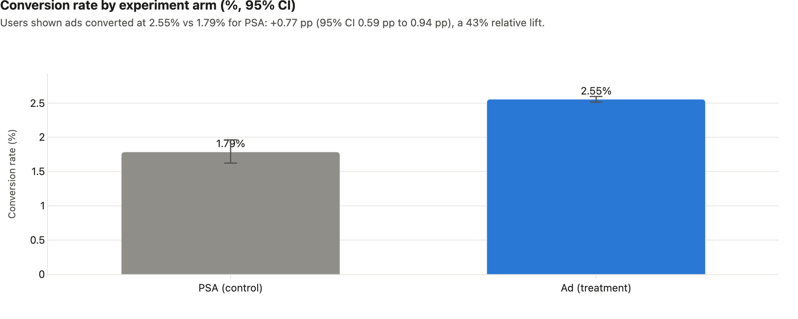 | 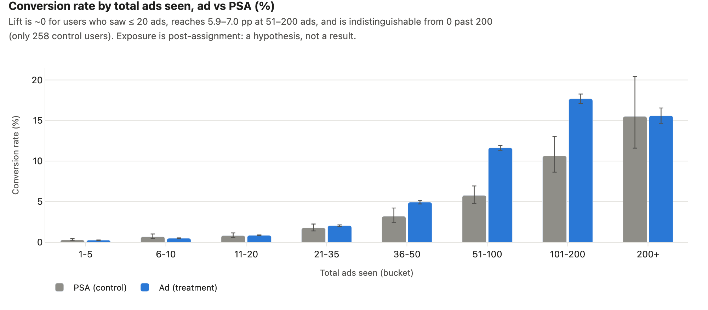 |
| 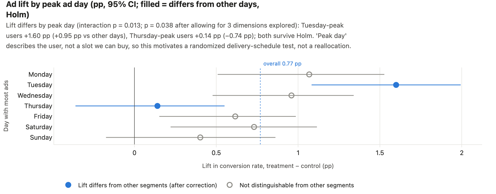 | 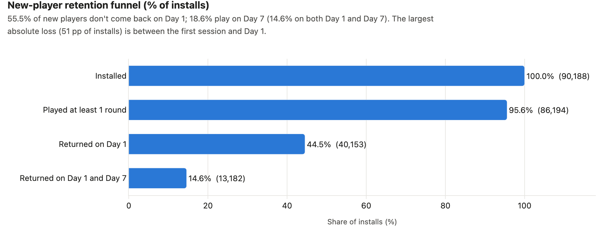<br>Installed 100% → Returned on Day 1 44.5% → Returned on Day 1 and Day 7 14.6%; drops 55.5 pp and 29.9 pp. |
| 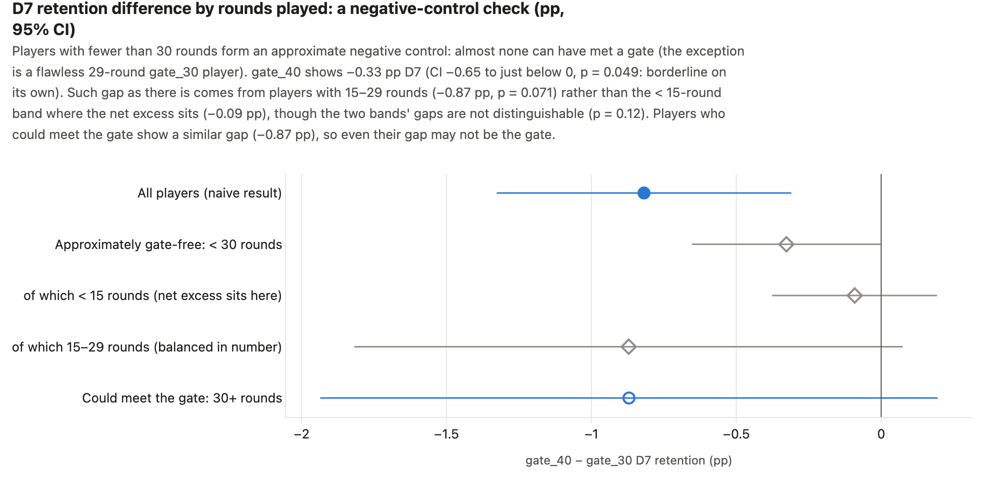 | 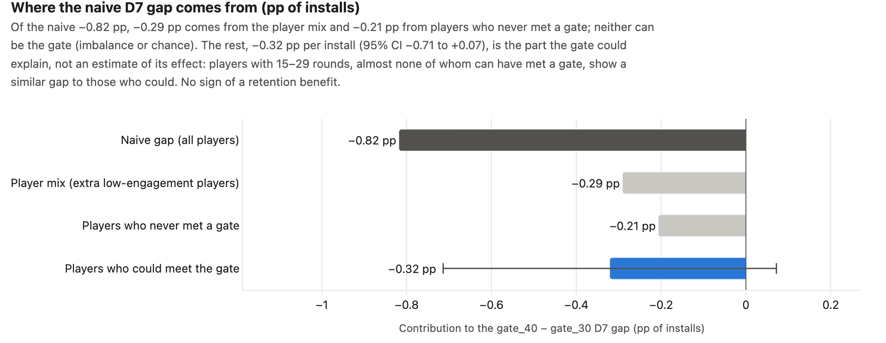 |

Every chart has a title with units and a one-sentence takeaway computed from the results. All 23 are in [reports/figures/](reports/figures/) and in the interactive report.

## Demo app (Streamlit)

The app has seven pages in presentation order. Each page opens with the question it answers and ends with a plain-language "How to read this". Every page is interactive:
- page 1 re-prices the breakeven CPM;
- page 3 re-cuts retention by segment;
- five pages re-run statistics live: the SRM rule, the CI method / alpha / power / split / holdout, the multiple-comparison correction, the gate sensitivity checks, and the sample-size calculator.

| | |
|---|---|
| 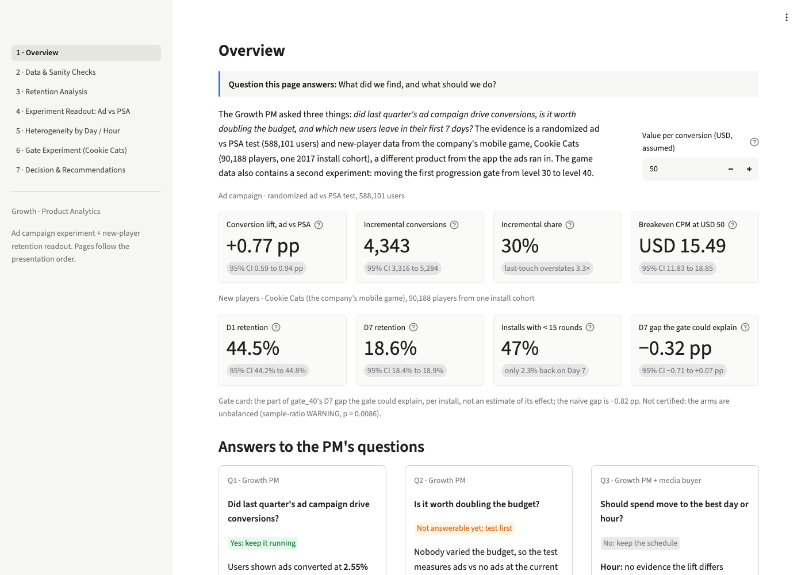 | 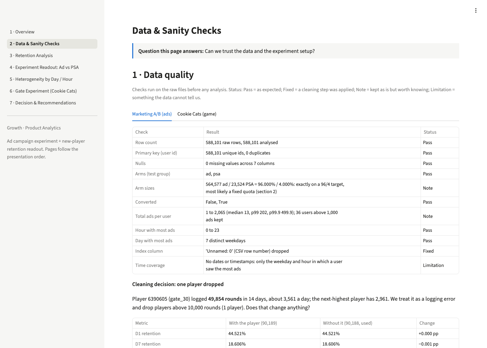 |
| 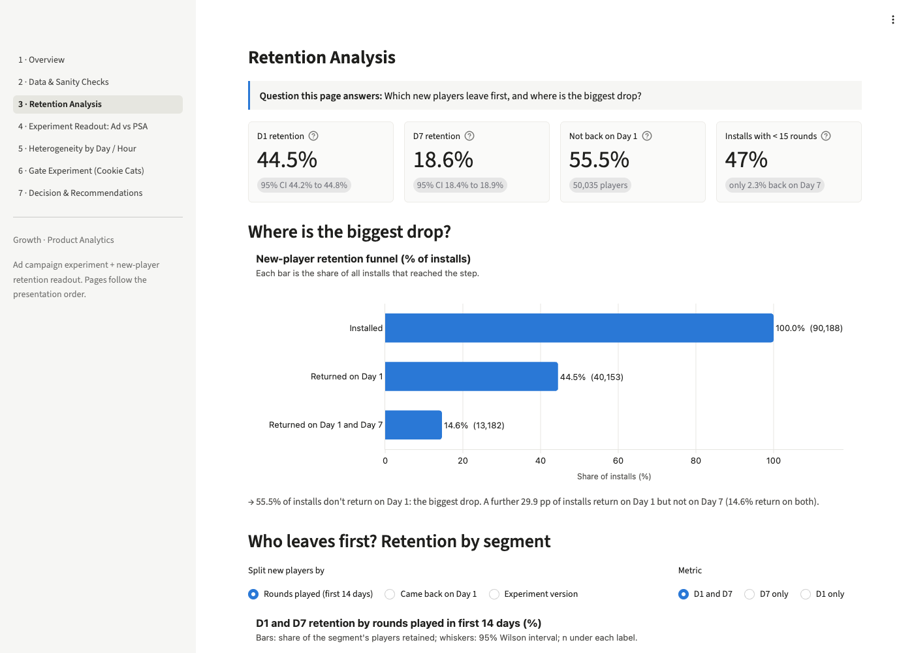 | 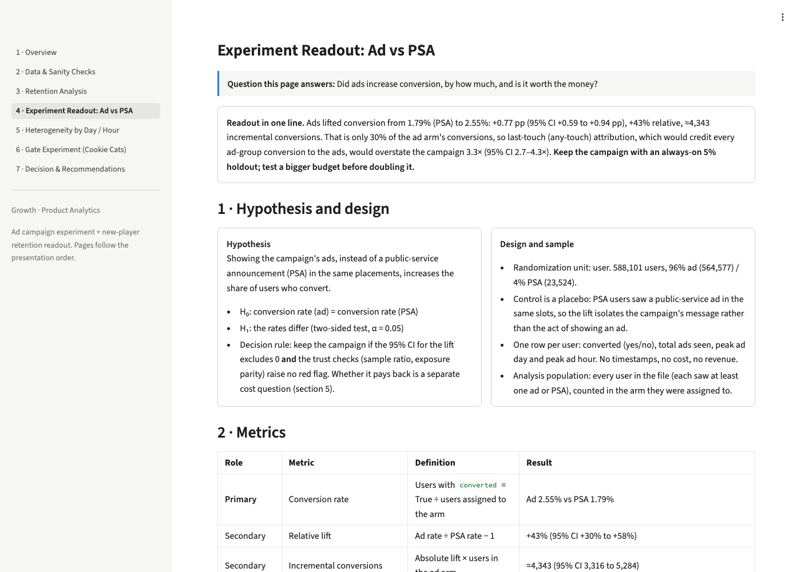 |
| 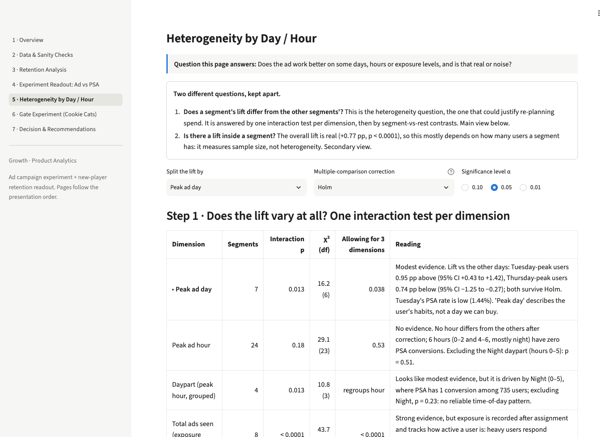 | 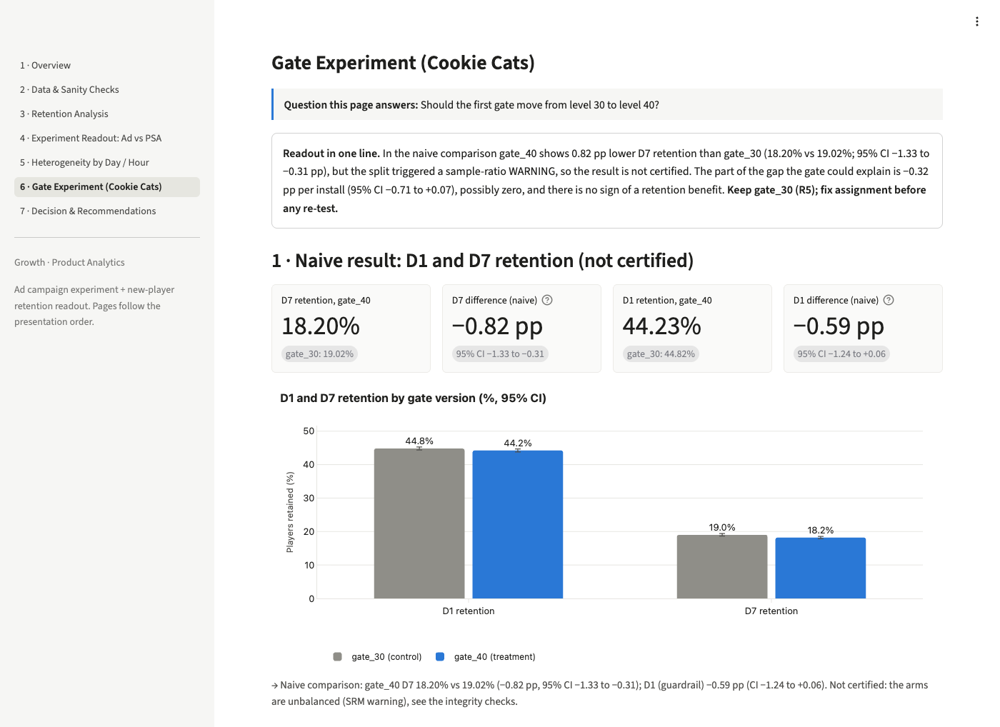 |
| 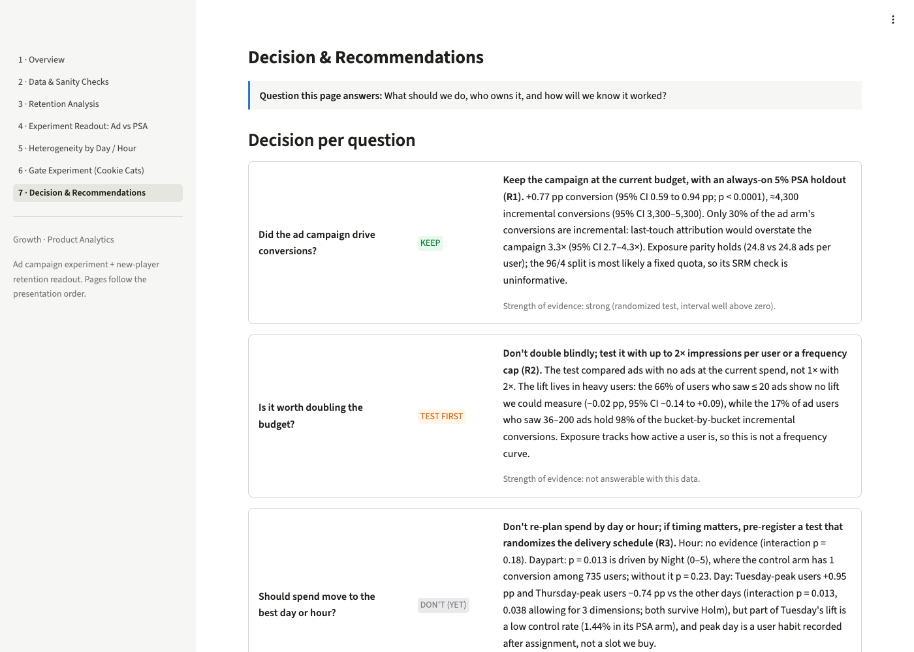 | |

## Method and data

**Data.** I use two public datasets because public user-level A/B data is rare.
- The [Marketing A/B test](https://www.kaggle.com/datasets/faviovaz/marketing-ab-testing) (2021) is a real ad-vs-PSA experiment but has no retention field.
- [Cookie Cats](https://www.kaggle.com/datasets/mursideyarkin/mobile-games-ab-testing-cookie-cats) (2017) is the company's other product in this role-play, a mobile game. It has D1/D7 retention, so it carries the retention analysis and a second experiment.
- Raw data is read from a configurable path and never committed.

**Sanity checks before results** ([docs/03_data_quality_checks.md](docs/03_data_quality_checks.md)):
- **Basic data checks.** Row reconciliation, key uniqueness, nulls and value domains all pass. One player logged 49,854 rounds in 14 days and is dropped as a logging error; no retention or gate conclusion changes (only mean rounds move; see the DQ log).
- **SRM.** The ad test's 96.000 / 4.000 split is most likely a fixed quota, so its SRM check passes by construction and proves little; exposure parity (24.8 vs. 24.8 ads per user) is the meaningful check. The gate test gets an SRM *warning*, which I located by rounds played.
- **Post-assignment variables.** Total ads, peak day and peak hour are recorded *after* assignment. They are never used as covariates, and segment results are labelled exploratory.

**Statistics** ([docs/02_metric_definitions.md](docs/02_metric_definitions.md)):
- **Main tests.** A two-proportion z-test with a Newcombe CI for the difference and a log-RR CI for relative lift, plus a count-level bootstrap as a cross-check.
- **Power.** Judged at the smallest lift worth acting on (10% relative, an explicit assumption), never at the observed effect.
- **Heterogeneity.** One interaction test per dimension (odds scale). Segment-vs-rest contrasts in percentage points (Agresti–Caffo intervals) with Holm / BH correction.
- **Gate experiment.** Arm sizes by rounds band, approximate negative controls (players with fewer than 30 rounds, almost none of whom can have met a gate), and an exact decomposition of the D7 gap into "player mix", "never met a gate" and "could be the gate". D1 and engagement guardrails are read where the gate can act. The re-test is sized at a pre-registered threshold.

**Assumptions** are logged one per line, each with how to validate it: [docs/assumptions.md](docs/assumptions.md).

**What's where**

| Deliverable | File |
|---|---|
| Stakeholder readout (decision first, no jargon) | [docs/readout.md](docs/readout.md) |
| Standalone interactive report (works offline) | [reports/report.html](reports/report.html) |
| Notebooks (EDA, retention, A/B test) + HTML exports | [notebooks/](notebooks/) · [reports/notebooks/](reports/notebooks/) |
| SQL a PM could ask you to hand-write (conversion, SRM, segments, retention, gate integrity), reconciled number by number with the Python results | [sql/](sql/) · [reports/tables/sql_reconciliation.csv](reports/tables/sql_reconciliation.csv) |
| Metric definitions · DQ log · assumptions | [docs/](docs/) |

## Limitations

- **No revenue or cost data.** Dollar figures rest on an assumed value per conversion (USD 50, adjustable in the app). The robust business number is incremental conversions.
- **No dates.** Neither dataset has timestamps, so novelty effects, test duration and seasonality can't be checked. "Peak day/hour" describes users, not media buys.
- **The ad test can't answer marginal spend.** Budget was never varied, so the 2× question needs its own experiment (R2).
- **Exposure is post-assignment and confounded with activity.** It shows where the lift lives (heavy users); it is not a frequency or dose-response curve.
- **Rounds played covers 14 days**, overlapping the D7 window, so rounds-vs-retention is partly definitional and descriptive.
- **The gate test's assignment is unbalanced.** Its estimate is not certified. Strata by rounds played are an approximation (there is no level field). The decision rests on "no sign of a retention benefit + status quo", not on a proven harm.

## How to run

```bash
make setup      # uv venv + pinned requirements (Python 3.12)
make all        # python run.py: data → checks → analysis → SQL reconciliation → figures → notebooks → report
make app        # streamlit run dashboard/app.py
```

- **Data location.** By default the raw CSVs are read from `~/projects/data-projects/datasets/...` (set in [config.yaml](config.yaml)). To point elsewhere, copy `.env.example` to `.env` and set `MARKETING_AB_CSV` / `COOKIE_CATS_CSV`.
- **Without make:** `uv venv --python 3.12 && uv pip install -r requirements.txt && .venv/bin/python run.py && .venv/bin/streamlit run dashboard/app.py`.
- **Pieces.**
  - `python run.py --only analysis` rebuilds the numbers and caches only.
  - `python -m src.sql_check` runs every SQL file and reconciles it with `reports/results.json`.
  - `make test` runs the dashboard tests.
  - `make notebooks` regenerates the three notebooks from their builders in `scripts/notebooks/` (each quoted number is a placeholder re-checked when the notebook runs), then executes and exports them.
- **Reproducibility.** All randomness uses a fixed seed (`config.yaml`), so two runs give identical numbers. Every number in this README comes from [reports/results.json](reports/results.json).

## Repository layout

```
docs/          request & scope, plan, metric definitions, DQ log, assumptions, readout
sql/           DuckDB SQL; each file runs on its own (input/output in the header)
src/           config, data cleaning, stats tests, retention, analysis pipeline, figure catalog, report builder, SQL reconciliation
notebooks/     01_eda, 02_retention, 03_ab_test (TL;DR first)
dashboard/     Streamlit app (7 pages) reading parquet caches only
reports/       results.json, tables, figures, screenshots, report.html, executive summary, notebook HTML exports
scripts/       notebook builders (scripts/notebooks/), README screenshots, fresh-clone check
run.py         one command for the whole pipeline (also: make all)
```
