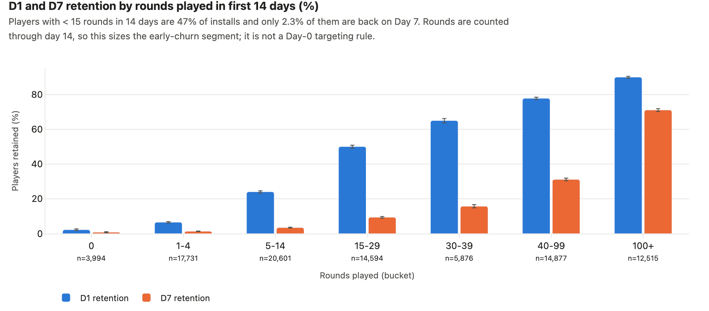

# Retention + A/B Test Analysis: Growth Experiment Readout

A Growth-team work sample: the experiment readout for a 588K-user ad campaign test and a new-player retention analysis (90K players), delivered the way a product analyst hands work to a PM. It includes SQL, Python, a Streamlit demo app, a standalone HTML report and a one-page decision memo.

**In three sentences.** The Growth PM asked whether last quarter's ad campaign drove conversions, whether its budget should double, and which new users churn first. I re-analyzed a randomized ad-vs-PSA experiment (588,101 users) and a mobile-game install cohort with its own A/B test (90,189 players). The methods were SQL (DuckDB) and Python: two-proportion tests with confidence intervals, SRM and power checks, and multiple-comparison-corrected segment analysis. Ads lifted conversion by **+0.77 pp (95% CI 0.59–0.94, +43%)**, but the test cannot justify doubling the budget, and new players are mostly lost between their first session and Day 1.

---

## The business question

> "Did last quarter's ad campaign actually drive conversions? If so, is it worth doubling the budget? Also, we're losing a lot of new users in their first 7 days. Which users leave first?" (Growth PM, weekly sync)

Clarified into five analysis questions with a decision owner each: see [docs/01_request_and_scope.md](docs/01_request_and_scope.md).

## Three findings

1. **The campaign works, but only ~30% of what it "gets credit for" is incremental.** Users shown ads converted at 2.55% vs. 1.79% for the PSA control: **+0.77 pp, 95% CI 0.59 to 0.94 pp**. That is about **4,300 incremental conversions** (95% CI 3,316–5,284), which is 30% of the ad group's conversions; last-touch attribution would overstate the campaign 3.3×. The data has no revenue, so the business translation uses an explicit assumption: at USD 50 per conversion, the campaign breaks even below **USD 15.49 CPM**.
2. **This test cannot justify doubling the budget.** It measures the *average* effect at today's spend, not the *marginal* effect of more spend. 98% of incremental conversions come from the 17% of users who saw 36–200 ads, and the 66% who saw 20 ads or fewer show no detectable lift. Ad volume tracks how active a user is, so this says "the lift lives in heavy users", not "more frequency works". By day of week the lift differs modestly (interaction p = 0.013; Tuesday-peak users respond more), but "peak day" is a user habit, not a slot we buy. By hour there is no evidence of a difference (p = 0.18).
3. **New players are lost before Day 1, and the gate test is not trustworthy as run.** 55.5% of installs don't return on Day 1; the 47% who play fewer than 15 rounds almost never reach Day 7 (≤ 3.4%). In the gate_30 vs. gate_40 test, the naive D7 gap is −0.82 pp, but assignment is unbalanced: gate_40 has 790 extra low-engagement installs (SRM p = 0.0086). Removing what the gate cannot have caused leaves **−0.32 pp per install (95% CI −0.71 to +0.07)**: probably small, possibly zero, with no sign of a benefit.

## Recommendations

| # | Owner | What | Expected impact | How we'll measure | Main risk |
|---|---|---|---|---|---|
| R1 | Growth PM | **Keep the campaign** at current spend, with an always-on 5% PSA holdout | ~4.3K incremental conversions per comparable flight; the holdout costs ~226 conversions per 588K users | Incremental conversion rate and cost per *incremental* conversion vs. the holdout | True CPM and value per conversion unknown: confirm actual CPM < breakeven with Finance |
| R2 | Growth PM + media buyer | **Don't double blindly; test it.** Randomized 2× budget / frequency-cap arms, sized with the MDE calculator | Learn the *marginal* return before committing ~2× spend | Incremental conversions per extra USD 1K (marginal iROAS) | Saturation / ad fatigue among heavy users |
| R3 | Media buyer | **Don't re-plan spend by day/hour yet.** Pre-register a daypart test (e.g. Tuesday vs. Thursday) | Avoid moving budget on a user-habit signal | Lift by bought daypart in the test | Chasing noise |
| R4 | Analytics + Eng | **Fix the next experiment's design:** 50/50 or 80/20 split (96/4 had 51% power for a 10% lift), assignment timestamps, pre-registered guardrails, SRM monitoring | Detect 10% lifts reliably with far fewer users | Power / MDE at design time; SRM dashboards | Larger holdout costs some conversions |
| R5 | Game PM | **Keep the gate at level 30.** Fix assignment logging before any re-test | Avoid a change with no sign of benefit | Re-test only if the gate placement matters (~276K installs at 50/50) | Missing a small real effect either way |
| R6 | Onboarding PM | **Focus retention work on first session → Day 1** with a Day-1 re-engagement experiment (D7 primary) | Largest pool to win back: 47% of installs | D7 retention (primary), D1 (secondary) | Rounds–retention link is correlational; the experiment must prove it |

Full readout for the PM: [docs/readout.md](docs/readout.md) · executive summary: [reports/executive_summary.md](reports/executive_summary.md)

## Key charts

| | |
|---|---|
|  |  |
|  |  |
|  |  |

Every chart has a title with units and a one-sentence takeaway; all 23 are in [reports/figures/](reports/figures/) and in the interactive report.

## Demo app (Streamlit)

Seven pages in presentation order. Each page opens with the question it answers and ends with a plain-language "How to read this". Five of them have controls that recompute results live: the SRM rule, the CI method / alpha / power / split / value per conversion, the multiple-comparison correction, the gate sensitivity checks, and the sample-size calculator.

| | |
|---|---|
|  |  |
|  |  |
|  |  |
|  | |

## Method and data

**Data.** I use two public datasets because public user-level A/B data is rare. The [Marketing A/B test](https://www.kaggle.com/datasets/faviovaz/marketing-ab-testing) (2021) is a real ad-vs-PSA experiment but has no retention field. [Cookie Cats](https://www.kaggle.com/datasets/mursideyarkin/mobile-games-ab-testing-cookie-cats) (2017) has D1/D7 retention, so it carries the retention analysis and a second experiment. Raw data is read from a configurable path and never committed.

**Sanity checks before results** ([docs/03_data_quality_checks.md](docs/03_data_quality_checks.md)):
- **Basic data checks.** Row reconciliation, key uniqueness, nulls and value domains all pass. One player logged 49,854 rounds in 14 days and is dropped as a logging error; results are unchanged with or without them.
- **SRM.** The ad test's 96.000 / 4.000 split is quota-exact, so its SRM check passes by construction and proves little. The meaningful check is exposure parity: 24.8 vs. 24.8 ads per user. The gate test gets an SRM *warning*, which I localized to low-engagement installs.
- **Post-assignment variables.** Total ads, peak day and peak hour are recorded *after* assignment. They are never used as covariates, and segment results are labelled exploratory.

**Statistics** ([docs/02_metric_definitions.md](docs/02_metric_definitions.md)):
- **Main tests.** Two-proportion z-test with a Newcombe CI for the difference and a log-RR CI for relative lift; a count-level bootstrap as a cross-check.
- **Power.** Measured at the smallest lift worth acting on (10% relative), not at the observed effect.
- **Heterogeneity.** One interaction test per dimension, then segment-vs-rest contrasts (Agresti–Caffo variance) with Holm / BH correction.
- **Gate experiment.** Negative controls (play before any gate; players who never met a gate), plus a decomposition of the D7 gap into "mix", "never met a gate" and "could be the gate".

**Assumptions** are logged one per line with how to validate each: [docs/assumptions.md](docs/assumptions.md).

**What's where**

| Deliverable | File |
|---|---|
| Stakeholder readout (decision first, no jargon) | [docs/readout.md](docs/readout.md) |
| Standalone interactive report (double-click to open, works offline) | [reports/report.html](reports/report.html) |
| Notebooks (EDA, retention, A/B test) + HTML exports | [notebooks/](notebooks/) · [reports/notebooks/](reports/notebooks/) |
| SQL a PM could ask you to hand-write (conversion, SRM, retention, gate integrity) | [sql/](sql/) |
| Metric definitions · DQ log · assumptions | [docs/](docs/) |

## Limitations

- **No revenue or cost data.** Dollar figures rest on an assumed value per conversion (USD 50, adjustable in the app). The robust business number is incremental conversions.
- **No dates.** Neither dataset has timestamps, so novelty effects, test duration and seasonality can't be checked; "peak day/hour" describes users, not media buys.
- **The ad test can't answer marginal spend.** Budget was never varied, so the 2× question needs its own experiment (R2).
- **Exposure is post-assignment and confounded with activity.** The dose-response pattern is a hypothesis, not an effect curve.
- **Rounds played covers 14 days**, overlapping the D7 window, so rounds-vs-retention is partly definitional and describes, rather than causes.
- **The gate test's assignment is imbalanced.** Its estimate is not certified; the decision rests on "no sign of benefit + status quo", not on a proven harm.

## How to run

```bash
make setup      # uv venv + pinned requirements (Python 3.12)
make all        # python run.py: data → checks → analysis → SQL reconciliation → figures → notebooks → report (~2 min)
make app        # streamlit run dashboard/app.py
```

- **Data location.** By default the raw CSVs are read from `~/projects/data-projects/datasets/...` (set in [config.yaml](config.yaml)). To point elsewhere, copy `.env.example` to `.env` and set `MARKETING_AB_CSV` / `COOKIE_CATS_CSV`.
- **Without make:** `uv venv --python 3.12 && uv pip install -r requirements.txt && .venv/bin/python run.py && .venv/bin/streamlit run dashboard/app.py`.
- **Pieces.** `python run.py --only analysis` rebuilds numbers and caches only. `python -m src.sql_check` runs every SQL file and reconciles it with `reports/results.json`. `make test` runs the dashboard tests.
- **Reproducibility.** All randomness uses a fixed seed (`config.yaml`), so two runs give identical numbers. Every number in this README comes from [reports/results.json](reports/results.json).

## Repository layout

```
docs/          request & scope, metric definitions, DQ log, assumptions, readout
sql/           DuckDB SQL, each file runs on its own (input/output in the header)
src/           config, data cleaning, stats tests, retention, analysis pipeline, figure builders, report builder, SQL reconciliation
notebooks/     01_eda, 02_retention, 03_ab_test (TL;DR first)
dashboard/     Streamlit app (7 pages) reading parquet caches only
reports/       results.json, tables, figures, screenshots, report.html, executive summary, notebook HTML exports
run.py         one command for the whole pipeline (also: make all)
```
